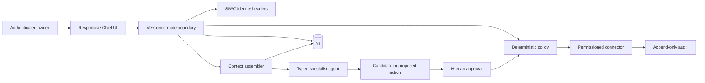

# Architecture

Chief is a Cloudflare Worker-compatible TypeScript application. React owns presentation; route handlers own identity, state validation, and API errors; deterministic domain modules own policy; D1 owns durable state; the OpenAI Agents SDK is optional synthesis infrastructure.

## Request flow

SIWC identifies the hosted owner. Development mode uses an explicit local-only identity from `.env`; production never falls back when authenticated headers are absent. D1 state is keyed by the stable owner ID. Mutations require a same-origin CSRF token, validate their typed envelope, compare optimistic versions, then persist.

## Retrieval flow

Resolve identity → resolve active workspace → filter authorized records → rank exact/semantic candidates → boost current canonical truth → penalize superseded or suspicious content → truncate deterministically → emit citation map. Workspace filtering occurs before ranking.

## Approval flow

Agents may create proposals. The UI shows exact target, payload, evidence, rationale, risk, expiration, and reversibility. R2 execution requires explicit approval. Connector methods independently re-check approval and workspace mapping. Idempotency keys ensure duplicate requests return the first result.

## Deployment

Vinext produces Cloudflare Worker ESM in `dist/server/index.js`; Sites binds D1, owns sign-in dispatch, packages migrations, and deploys an owner-only version.
