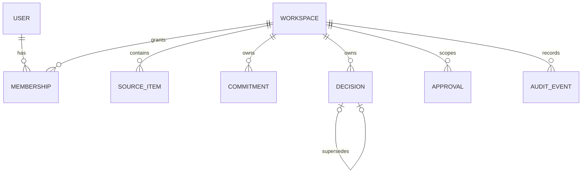

# Data model

The TypeScript contracts in `lib/types.ts` are the current application boundary. `db/schema.ts` defines normalized production tables for users, workspaces, memberships, sources, commitments, decisions, approvals, audit events, and snapshots.

Truth states are `OBSERVED`, `AI_CANDIDATE`, `APPROVED`, `SUPERSEDED`, and `REJECTED`. Observed means the source was actually retrieved, not that its content is true. Rejected candidates are retained for audit/evaluation but excluded from normal truth retrieval.

Decision history is preserved with `supersedes`/`supersededBy`. Commitment fulfillment requires owner action or evidence; a model never marks fulfillment. Common queries index workspace plus status/date. Source deletion should revoke excerpts and derived chunks while retaining non-content provenance on canonical records.
